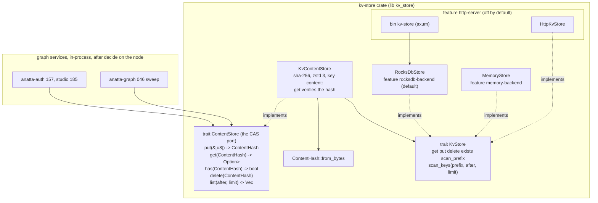

# 001 Revive kv-store as the anatta CAS

status: merged
rank: 8 (wave 1's first task; 046, 157 and 185 depend on it; small surface, no engine coupling)
level: standard (4-6): one crate, one port reshaped, no rights; no deployed CAS data is known (unknown, not checked beyond this repository)
request: the user, 2026-11-07: "on n'a pas un repo kv/store ? je crois que dans mon ancienne version j'avais déjà ça". Plan wording (`~/.claude/plans/crispy-sauteeing-gosling.md`, Wave 1, task 001): "revive: workspace toolchain, clippy pedantic, `ContentStore` as the CAS port (`put(bytes)→hash`, `get`, `has`), rocksdb + memory, tag v0.2.0; HTTP bin kept but off by default"; oracle "15+ tests on both backends; a 1 GB put/get soak".
repository: kv-store (`~/projects/anatta/anatta-infra/services/kv-store`, remote `git@github.com:anatta-rs/kv-store.git`, branch `main`, HEAD `e0a3612` 2026-04-28, no tags)
depends: none
model: lanes on Codex (plan, Execution); Opus lead supervises

## Summary

**Asked.** Make the user's existing kv-store the one content-addressed store (CAS) of a deployment (plan §11): blobs by sha-256, no tenant, never on a transport a caller reaches; services read a blob after `decide` on the graph node that references it.

**Decided.**
- D1. The CAS is this crate, revived, not rewritten (plan, Context).
- D2. `put(&[u8]) -> ContentHash`: the store computes the hash itself. The caller-supplied hash of today (`src/content.rs:39`) goes; no `put_with_hash` (Fable, 2026-11-07).
- D3. Reads: `get(ContentHash)`, `has(ContentHash)`.
- D4. Backends: rocksdb and memory; the memory backend leaves the test module (`src/content.rs:78-121`) and becomes the `memory-backend` feature (today `Cargo.toml:24`, gating nothing).
- D5. The HTTP bin stays but is off by default.
- D6. Tag `v0.2.0` (annotated) on `main` after merge.
- D7. Clippy pedantic with `-D warnings`, functions under 50 lines, sccache, `scripts/check.sh` (rust-anatta skill).
- D8. Oracle: 15+ tests on both backends (one generic suite, instantiated twice); a 1 GiB put/get soak behind `#[ignore]`.
- D9. No Studio project exists for kv-store (project_list 2026-11-07); none is created by this task (Fable: "fine as recorded").
- D10 (Q1). `ContentStore` is a **trait, the port**, with one impl over `KvStore`. The port also has `list`, paged, over `scan_prefix("content:")`: anatta-graph 046 (sweep) reads it (Fable, 2026-11-07).
- D11 (Q2). `delete` is kept on the port.
- D12 (Q3). sled is dropped: the `sled` dependency and the `sled-backend` feature go.
- D13 (Q4). License Apache-2.0, as the README says: the user ruled for the one that lets us sell what we build, and Apache-2.0 adds the explicit patent grant; `Cargo.toml:6` changes from MIT, a `LICENSE` file is added (the user, 2026-11-07; replaces the MIT line).
- D14 (Q5). Lib renamed `kv_store`; `repository = "https://github.com/anatta-rs/kv-store"`.
- D15 (Q6). A single crate with the shared toolchain files (`rust-toolchain.toml`, `scripts/env.sh`, `clippy.toml`); no Cargo workspace.
- D16 (Q7). `HttpKvStore` and the bin both behind one off-by-default feature `http-server`.
- D17 (Q8). `Cargo.lock` is committed (removed from `.gitignore`); `scripts/check.sh` runs `--locked`.
- D18. The README is rewritten in 001: no polystore, the real API, the bin off by default, the port.

- D19 (Q9). Add `KvStore::scan_keys(prefix: &str, after: Option<&str>, limit: usize) -> Vec<String>`, keys only, paged; `ContentStore::list` is built on it (not on `scan_prefix`, which reads values). `HttpKvStore::scan_keys` returns an `Unsupported` error (new variant `KvError::Unsupported(String)`); the bin gets no keys-only route in this task (Fable, 2026-11-07).
- D20 (Q9). The impl over `KvStore` is named `KvContentStore<K>` (Fable, 2026-11-07).
- D21. `ContentStore::list` yields `(hash, stored_at)`, `stored_at` the backend's write time recorded on `put` (memory and rocksdb both); a re-put of an existing hash keeps the first time. The CAS sweep (anatta-graph 046) needs it for its grace window (the coordinator, 2026-11-08).
- D22 (Q10). `stored_at` is kept in a sibling key `content-at:<hex>`: 8 bytes, u64 big-endian unix milliseconds, written before the blob and only when the blob is new, removed with it by `delete`; `list` pages over `scan_keys("content:")` and reads only the small time values. Type `std::time::SystemTime`: `list` returns `Vec<(ContentHash, SystemTime)>`. A listed blob without a time is reported as `UNIX_EPOCH` (an unreferenced blob is an orphan whatever its age; the grace only protects a blob just written); a test covers it. The CAS suite grows by four cases (`list_reports_stored_at`, `reput_keeps_first_stored_at`, `list_without_time_is_epoch`, `delete_removes_stored_at`): 19 cases, 39 tests with the reopen case (the coordinator, 2026-11-08).
- D23 (review). `KvContentStore` serialises `put` and `delete` with a process-local mutex (one process owns a store): the `content-at:` time is the first writer's and a delete racing a put cannot leave a blob without its time; the doc says the store is single-process; a test races two tasks on one hash (the coordinator, 2026-11-08). Lead's reading: one async mutex per store (`tokio::sync::Mutex<()>`; a std guard cannot cross the `await` of a `Send` future), so `tokio` with only its `sync` feature becomes an unconditional dependency; `get`, `has` and `list` take no lock.
- D24 (review). `list` skips a key under `content:` that is not a canonical lowercase 64-hex hash, with one `tracing::warn!` per call naming the count; never an error (the coordinator, 2026-11-08). Lead's reading, so that pages stay exact: `list` keeps scanning past skipped keys until it has `limit` hashes or the keys end (a short page still means the end), the cursor being the last key scanned.
- D25 (review). Tests gate only their memory cases on `memory-backend` (rocksdb cases on `rocksdb-backend`), so plain `cargo test` runs the rocksdb half. `KvStore::scan_keys` is listed under Breaking in the CHANGELOG. A non-UTF-8 rocksdb key is `KvError::Backend` in both `scan_keys` and `scan_prefix`. `MemoryStore` has one private `guard()`. The bin's tracing filter is `kv_store` and its doc drops sled (the coordinator, 2026-11-08).

**Ruled out.** A new CAS crate; the CAS behind HTTP for services (§11); tenancy or rights in the CAS; the sweep itself (046); sled; a Cargo workspace; `put_with_hash`.

**Open.** None for 001 (Q10 answered: D22). For later tasks (the review, 2026-11-08):
- `put` on a hash whose stored body is corrupt returns `Ok` without repairing it (a repair path).
- The async facade runs hashing, zstd and rocksdb inline on the caller's task (`spawn_blocking` or a sync port; to decide with the first async consumer).
- `list` does one point read per key for its time (a `scan` returning values would make a page one range read).
- Q9 (answered, kept for the record). `list` paged "over `scan_prefix`": today's `KvStore::scan_prefix` (`src/store.rs:30-33`) returns every key **with its value**, unpaged, so one page of hashes built on it reads every blob of the store into memory (1 GiB at the soak's size). Options: (a) add a keys-only paged method to `KvStore`, `scan_keys(prefix, after, limit)`, rocksdb seeking from `after`, and build `list` on it [lean; written below as proposed]; (b) build `list` on `scan_prefix` as is and accept the cost until 046 measures it; (c) `list` returns a `Stream` fed by a rocksdb iterator (adds `futures-core`; `KvStore` grows a stream method anyway). With (a), `HttpKvStore::scan_keys`: unsupported error, or a new keys-only route on the bin? Also confirm the impl's name `KvContentStore<K>` (proposed).

## Grounded context and impact

GitSense was down (ECONNREFUSED); kv-store's presence in the `anatta` index is unknown. Files read locally with the Read tool at `e0a3612`.

**History.** `52681dd` "initial extract from anatta-rs/Anatta"; `e0a3612` (2026-04-28) "absorb polystore-rocksdb impl as rocksdb-backend feature", renamed kv-server → kv-store, "polystore-rocksdb repo becomes redundant".

**polystore.** `README.md:3` says the crate implements `polystore::KvStore`. **The crate no longer depends on polystore**: `Cargo.toml:26-40` has no `polystore` entry; the trait is local, `src/store.rs:14`. The README is stale (D18).

**Files and symbols.**
- `Cargo.toml:1-56`: package `kv-store` 0.1.0, edition 2024; `[[bin]] kv-store` at `src/bin/kv-server.rs`, `required-features = ["rocksdb-backend"]` (`:11-14`), so today the bin is **built by default**; `[lib] kv_server` (`:16-18`); features `default = ["rocksdb-backend"]`, `sled-backend`, `memory-backend = []` (`:20-24`); `repository` `anatta-rs/kv-server` (`:7`); lints `unsafe_code = "deny"`, `missing_docs = "warn"`, clippy groups with `pedantic = warn` and four allows (`:42-56`). No `clippy.toml`, no `rust-toolchain.toml`, no `LICENSE`.
- Dependencies (`Cargo.toml:27-40`, requirements; resolved versions unknown, no `Cargo.lock`, `.gitignore:2`): axum 0.8, serde 1.0 (derive), serde_json 1.0, tokio 1 (full), tracing 0.1, tracing-subscriber 0.3 (env-filter), tower-http 0.6 (trace, cors), thiserror 2, sha2 0.10, hex 0.4, zstd 0.13, rocksdb 0.23 (optional), sled 0.34 (optional), reqwest 0.12 (json). axum, tokio full, tower-http, tracing-subscriber, serde_json and reqwest are **unconditional** today.
- `src/lib.rs:14-28`: modules and re-exports `ContentStore`, `KvError`, `ContentHash`, `HttpKvStore`, `RocksDbStore` (cfg), `KvStore`. Doc `:6-7` claims sled and memory backends: **neither exists as code**.
- `src/store.rs:14-34` `KvStore: Send + Sync`: `get`, `put(&str, Vec<u8>)`, `delete`, `exists`, `scan_prefix(&str) -> Vec<(String, Vec<u8>)>`, all `impl Future + Send` (RPITIT, the idiom the new port follows); blanket `impl KvStore for &T` (`:37-60`).
- `src/content.rs`: `ContentStore<K: KvStore> { inner: K }` (`:19-22`, `#[allow(dead_code)]`); `new` `:26`, `inner` `:31`; `put(hash, body)` `:39-44`, zstd level 3 (`:11`), key `content:<hex>`, **never checks the hash against the body**; `get` `:47-57`; `has` `:60-63`; `delete` `:66-69` (doc mentions Neo4j). Tests `:123-263`: 10, memory only, each with its own `Runtime`; `get_absent_key_returns_none` (`:164-171`) **asserts nothing**.
- `src/hash.rs`: `ContentHash([u8; 32])` serde-transparent (`:7-9`), `from_bytes` sha-256 (`:15-22`), `as_hex` `:25`, `hex` `:30`, `as_bytes` `:35`, `From<[u8;32]>` `:40`, `TryFrom<&str>` (`Error = String`, `:50-62`), `Display` `:64`; 5 tests `:74-107`.
- `src/error.rs:5-21` `KvError { Backend, InvalidKey, Serialization, HashMismatch }`; `HashMismatch` unused today; `From<rocksdb::Error>` `:23-28`.
- `src/rocksdb.rs`: `RocksDbStore { db }` (`:11-13`), `open(&Path)` with a zero-length fixed prefix extractor (`:21-27`, effect unknown), blocking calls inside `async fn` (`:31-69`), `scan_prefix` seeks with `IteratorMode::From` and stops at the first non-matching key (`:49-69`). **No tests.**
- `src/http.rs`: `HttpKvStore` client over reqwest (`:12-31`), `KvStore` impl over `/kv/{key}` (`:33-136`), hand-written base64 decoder (`:145-184`).
- `src/bin/kv-server.rs`: binds `0.0.0.0:$KV_PORT` (8080, `:28-30`), data `$KV_DATA_PATH` (`/data/kv`), routes `/health`, `GET|PUT|DELETE|HEAD /kv/{key}`, `GET /kv?prefix=` (`:35-41`), 50 MiB limit (`:43`), **permissive CORS** (`:44`), no auth; serves the raw `RocksDbStore`, not the CAS. Uses `kv_server::{KvStore, RocksDbStore}` (`:18`): renamed by D14. README's `/scan?prefix=` (`README.md:52`) is stale.
- `.github/workflows/ci.yml`: fmt, clippy/test/check `--all-features` on `dtolnay/rust-toolchain@stable`.
- `README.md:21-27`: example uses `kv_store::` with byte keys: stale.

**Why the HTTP bin stays off by default.** §11: the CAS is never on a transport a caller reaches; a blob is read after `decide` on its node. The bin listens on every interface with permissive CORS, no auth, raw keys (`kv-server.rs:30,44`); built by default it invites exactly that. Kept behind `http-server` for the user's own use (docker-compose, `kv-server.rs:5`).

**Impact.** No dependent repository is known (unknown: GitSense down; `get_impact` when it is up). Future callers: anatta-graph 046 (`list`, `delete`), anatta-auth 157, studio 185. Breaking changes: `put` signature, `ContentStore` from struct to trait, lib name `kv_server` → `kv_store`, sled removed: 0.1.0 → 0.2.0.

**Toolchain model (gitsense).** `rust-toolchain.toml` channel 1.99 + rustfmt, clippy; `clippy.toml` `too-many-lines-threshold = 50`; `scripts/env.sh` exports `RUSTUP_HOME=$HOME/.rustup-pc/rustup`, `CARGO_HOME=$HOME/.rustup-pc/cargo`, PATH; `scripts/check.sh` sources it. anatta-graph's `scripts/check.sh` adds `--locked --offline` and `RUSTDOCFLAGS="-D warnings" cargo doc`. anatta-graph has `AGENTS.md`, not `CLAUDE.md`; gitsense's `CLAUDE.md` is the model.

**Sippa.** `find_decision` (CAS, 2026-11-07): no CAS decision; nearest gitsense r4, d16, not binding. `discover`: rust-anatta, run-lane, development.

## Design

TARGET:



`put` hashes the plain bytes (identity is the content, not its compressed form), returns early when `has` is true, compresses, writes. `get` decompresses and re-hashes: a mismatch is `KvError::HashMismatch` (`error.rs:19`). `list` strips `content:` and parses hex; a key that does not parse is `KvError::InvalidKey`. The bin depends on a backend, never the reverse; nothing in the default feature set opens a socket.

## AST target

Crate `kv-store` 0.2.0, lib `kv_store`, edition 2024, single crate (D15).

**`Cargo.toml`**
- `repository = "https://github.com/anatta-rs/kv-store"`, `license = "Apache-2.0"`, description "Content-addressed store (sha-256, zstd) over a key-value port; rocksdb and memory backends; optional HTTP server."; keywords without `polystore`.
- `[lib] name = "kv_store"`.
- `[features]`: `default = ["rocksdb-backend"]`; `rocksdb-backend = ["dep:rocksdb"]`; `memory-backend = []`; `http-server = ["dep:axum", "dep:tower-http", "dep:tracing-subscriber", "dep:reqwest", "dep:serde_json", "tokio/full"]`. sled removed (D12).
- `[dependencies]`: unconditional `thiserror`, `sha2`, `hex`, `zstd`, `serde` (derive, for `ContentHash`), `tracing`; `tokio` optional under `http-server` if the lib needs none of it (unknown until lane 1 builds; the lib code read today uses no tokio item outside tests and the bin); the HTTP stack optional.
- `[dev-dependencies]`: `tokio` (`rt-multi-thread`, `macros`), `tempfile`.
- `[[bin]] name = "kv-store"`, `path = "src/bin/kv-server.rs"`, `required-features = ["rocksdb-backend", "http-server"]`.
- `[lints.rust] unsafe_code = "forbid"`, `missing_docs = "warn"`; clippy groups kept.

**`src/lib.rs`**: `pub mod content; pub mod error; pub mod hash; pub mod store;` `#[cfg(feature = "memory-backend")] pub mod memory;` `#[cfg(feature = "rocksdb-backend")] pub mod rocksdb;` `#[cfg(feature = "http-server")] pub mod http;` Re-exports `ContentStore`, `KvContentStore`, `ContentHash`, `KvError`, `KvStore`, and the cfg'd `MemoryStore`, `RocksDbStore`, `HttpKvStore`. Crate doc: the CAS, §11's rule that it is never on a reachable transport.

**`src/content.rs`** (the port, D10)
```rust
pub const CONTENT_PREFIX: &str = "content:";
pub trait ContentStore: Send + Sync {
    fn put(&self, body: &[u8]) -> impl Future<Output = Result<ContentHash, KvError>> + Send;
    fn get(&self, hash: ContentHash) -> impl Future<Output = Result<Option<Vec<u8>>, KvError>> + Send;
    fn has(&self, hash: ContentHash) -> impl Future<Output = Result<bool, KvError>> + Send;
    fn delete(&self, hash: ContentHash) -> impl Future<Output = Result<(), KvError>> + Send;
    /// Hashes in ascending hex order, strictly after `after`, at most `limit`.
    fn list(&self, after: Option<ContentHash>, limit: usize)
        -> impl Future<Output = Result<Vec<ContentHash>, KvError>> + Send;
}
pub struct KvContentStore<K: KvStore> { inner: K }   // D20
impl<K: KvStore> KvContentStore<K> { pub fn new(inner: K) -> Self; pub fn inner(&self) -> &K; }
impl<K: KvStore> ContentStore for KvContentStore<K> { /* five methods */ }
fn key(hash: ContentHash) -> String;                           // "content:<hex>"
fn compress(body: &[u8]) -> Result<Vec<u8>, KvError>;          // zstd level 3
fn decompress_verified(hash: ContentHash, raw: &[u8]) -> Result<Vec<u8>, KvError>;
fn hash_from_key(key: &str) -> Result<ContentHash, KvError>;
```
Today's test module moves to `tests/cas.rs`; its `InMemoryKvStore` is deleted (replaced by `MemoryStore`).

**`src/store.rs`** (D19): add
```rust
/// Keys starting with `prefix`, strictly after `after`, ascending, at most `limit`; values not read.
fn scan_keys(&self, prefix: &str, after: Option<&str>, limit: usize)
    -> impl Future<Output = Result<Vec<String>, KvError>> + Send;
```
and its blanket `&T` delegation. Implemented in `rocksdb.rs` (`IteratorMode::From(after or prefix)`, skip `after` itself, stop at prefix end or `limit`), `memory.rs` (`BTreeMap::range`), `http.rs` (returns `KvError::Unsupported`, D19). `src/error.rs` gains `#[error("unsupported: {0}")] Unsupported(String)`.

**`src/memory.rs`** (new, `memory-backend`): `#[derive(Default)] pub struct MemoryStore { map: std::sync::Mutex<BTreeMap<String, Vec<u8>>> }`, `pub fn new() -> Self`, `impl KvStore` (a poisoned lock maps to `KvError::Backend`, no `unwrap`).

**Unchanged API**: `src/rocksdb.rs` (plus `scan_keys`), `src/hash.rs`, `src/error.rs` (plus `Unsupported`). `src/http.rs`: cfg `http-server`. `src/bin/kv-server.rs`: `use kv_store::…`; otherwise unchanged (it serves the raw `KvStore`; the README says so).

**Repository files**
- `rust-toolchain.toml`: channel `1.99`, components rustfmt, clippy (gitsense's). `clippy.toml`: `too-many-lines-threshold = 50`. `scripts/env.sh`: gitsense's three exports.
- `scripts/check.sh` (sh, `set -eu`, sources `scripts/env.sh` when `$HOME/.rustup-pc` exists, never touches `RUSTC_WRAPPER`): `cargo fmt --all --check`; `cargo clippy --locked --all-targets -- -D warnings` (default); `cargo clippy --locked --no-default-features --features memory-backend --all-targets -- -D warnings`; `cargo clippy --locked --features memory-backend,http-server --all-targets -- -D warnings`; `cargo test --locked --features memory-backend`; `RUSTDOCFLAGS="-D warnings" cargo doc --locked --features memory-backend,http-server --no-deps`.
- `.gitignore`: the `Cargo.lock` line removed; `Cargo.lock` committed (D17).
- `.github/workflows/ci.yml`: one job, `dtolnay/rust-toolchain@1.99` with rustfmt, clippy, then `sh scripts/check.sh`.
- `CLAUDE.md` (new): the Anatta header (as gitsense's: Sippa calls, GitSense reading); the crate is the deployment's CAS (plan §11); never on a reachable transport, `http-server` off by default; the check; sccache and `cargo sweep --time 7`; releases (semver, `CHANGELOG.md`, annotated tag on `main`); commits (Conventional, staged by path, squash merge).
- `LICENSE` (Apache-2.0, 2026, holder as the user's GitHub identity). `CHANGELOG.md` (new): `## 0.2.0` with the breaking changes. `README.md` rewritten (D18): what it is, the port with an example on `KvContentStore<MemoryStore>` (a doctest), features table (rocksdb default, memory, http-server off), the bin's real routes (`/kv?prefix=`) and its warning (no auth, all interfaces), Apache-2.0.

**Tests**
- `tests/cas.rs`: each case `async fn <case><S: ContentStore>(s: &S)`, called by two `#[tokio::test]` wrappers `memory_<case>` and `rocksdb_<case>` (tempdir), generated by `macro_rules! both_backends`. Cases (15): `put_returns_sha256_of_body`, `put_then_get_roundtrip`, `put_twice_is_one_entry`, `put_empty_body`, `get_absent_is_none`, `has_false_before_true_after`, `non_utf8_roundtrip`, `large_body_2mib_roundtrip`, `stored_bytes_are_compressed`, `concurrent_puts_same_body`, `distinct_bodies_distinct_hashes`, `get_detects_corruption` (raw key overwritten through `inner()`: `HashMismatch`), `delete_then_absent`, `list_pages_in_hex_order` (25 blobs, limit 10: 10, 10, 5, no repeats, all found), `list_ignores_other_prefixes`. Rocksdb only: `rocksdb_reopen_keeps_blobs`. Total 31.
- `tests/kv.rs` (both backends): `scan_prefix_sorted`, `scan_keys_after_and_limit`, `delete_missing_is_ok` (6).
- `src/hash.rs` tests kept (5).
- `tests/soak.rs`: `#[ignore] #[tokio::test] soak_1gib_put_get_rocksdb`: 1024 distinct 1 MiB seeded incompressible bodies; put all, get all and compare hashes, `list` pages count 1024; prints elapsed and on-disk size.

**Release**: `version = "0.2.0"` in the diff; after merge, `CHANGELOG.md` dated, annotated tag `v0.2.0` on `main`.

## Lanes

Codex lanes, sequential (lanes 1-3 share `Cargo.toml`, `src/lib.rs`, `src/content.rs`); lane 4's docs may run beside lane 3. Each lane gets D1-D20, writes tests red first, runs one check, commits, and writes `QUESTION.md` instead of guessing.

| # | Lane | Files | After | Runner | Tokens | Calls | Commit | State | Questions |
|---|---|---|---|---|---|---|---|---|---|
| 1 | toolchain and features | `rust-toolchain.toml`, `clippy.toml`, `scripts/env.sh`, `scripts/check.sh`, `Cargo.toml` (lib rename, features, sled out, lints, optional deps), `Cargo.lock`, `.gitignore`, `src/lib.rs` (cfgs), `src/http.rs` (cfg only), `src/bin/kv-server.rs` (`kv_store::`), `.github/workflows/ci.yml`, `CLAUDE.md`, `LICENSE`; oracle: `scripts/check.sh` green on today's tests; `cargo tree` default has no axum | — | Codex | 1,173,738 in (1,115,520 cached), 8,075 out | 38 | `41167ee` | done | 0 |
| 2 | memory backend and scan_keys | `src/memory.rs`, `src/store.rs`, `src/rocksdb.rs`, `src/http.rs` (`scan_keys` → `Unsupported`), `src/error.rs`, `src/lib.rs`, `tests/kv.rs`; oracle: `tests/kv.rs` green on both backends | 1 | Codex | 1,019,029 in (972,160 cached), 6,918 out | 22 | `847c37a` | done | 0 |
| 3 | the CAS port | `src/content.rs`, `tests/cas.rs`; tests red first; oracle: 31 tests green | 2 | Codex | 824,691 in (745,088 cached), 8,136 out | 28 | `63882e1` | done | 0 (Q10 raised by the lead on D21, before launch) |
| 4 | soak and docs | `tests/soak.rs`, `README.md`, `CHANGELOG.md`; oracle: `--ignored soak_1gib_put_get_rocksdb` passes, README doctest compiles | 3 | Codex | 1,918,735 in (1,866,624 cached), 10,790 out | 50 | `d26f1c0` | done | 0 |
| 5 | review: the port | `src/content.rs`, `tests/cas.rs`, `Cargo.toml`, `Cargo.lock` (tokio `sync`); D23, D24, D25 (tests); red first | 4 | Codex | 787,745 in (741,248 cached), 7,391 out | 28 | `f61a968` | done | 0 |
| 6 | review: backends, bin, changelog | `src/bin/kv-server.rs`, `src/memory.rs`, `src/rocksdb.rs`, `tests/kv.rs`, `CHANGELOG.md`; D25 | 4, beside 5 | Codex | 537,613 in (499,840 cached), 3,127 out | 20 | `bc9a5a0` | done | 0 |

## Acceptance

- `scripts/check.sh` green on toolchain 1.99: clippy pedantic `-D warnings` on three feature sets, rustdoc `-D warnings`, `--locked`.
- `cargo tree -e normal` with default features lists no axum, tower-http, reqwest.
- 15 CAS cases pass on memory and on rocksdb (31 tests with the reopen case; 19 cases and 39 tests with D22); `put` returns `ContentHash::from_bytes(body)`; `list` pages exactly.
- `cargo test --release --test soak -- --ignored` passes; time and disk size recorded in the Log.
- `LICENSE` Apache-2.0; README and CHANGELOG match the code; annotated tag `v0.2.0` on `main`.

## Workflow contract

Current step: merged to `main` and tagged `v0.2.0` (2026-11-08)
Input: plan Wave 1 row 001, Fable's answers Q1-Q9 (2026-11-07), this grounded context
Artifact: this TARGET and AST target
Target thread: none (no Studio project, D9)
Next persona: none for 001; the Open items go to later tasks
Validation gate: TARGET and AST target validated by the user (go, 2026-11-08); next gate: review

## Studio

No Studio project for kv-store (project_list, 2026-11-07: 15 projects, none for kv-store). Not created (D9). The eight threads are opened if a project is created later.

## Log

- 2026-11-07 Opus lead: grounded at `e0a3612` by local reads (GitSense down); Sippa find_decision and discover; Q1-Q8 sent to Fable.
- 2026-11-07 Fable answered Q1-Q8 (D10-D18). AST target and lanes completed; Q9 (paging `list` over an unpaged, value-loading `scan_prefix`; impl name) sent to Fable. Nothing committed, no build run.
- 2026-11-07 Fable answered Q9: keys-only paged `scan_keys`, `HttpKvStore` returns `Unsupported`, no bin route; `KvContentStore<K>` confirmed (D19, D20). Lanes 2 and 3 unblocked; all lanes wait for the user's gate.
- 2026-11-07: the user ruled the license: Apache-2.0 (D13 revised); the manifest aligns to the README.
- 2026-11-08 Opus lead: the user said go (run to review-ready, no merge). Task branch `task/001-revive-content-store` from `b907571` in `~/projects/anatta/wt/kv-store-001`; lanes on Codex.
- 2026-11-08 lane 1 (Codex): red `axum v0.8.9` in the default tree; green: 15 tests, check.sh pass, default tree without axum/tower-http/reqwest. Lint-only `#[expect(clippy::unused_async_trait_impl)]` on the rocksdb and test `KvStore` impls. The Codex sandbox cannot write the worktree's git dir (`index.lock`, even with `--add-dir .git`): the lead commits the lane's files by path.
- 2026-11-08 lane 2 (Codex): red `unresolved import kv_store::MemoryStore`; green `tests/kv.rs` 6 passed, check.sh pass (21 tests). Integrated.
- 2026-11-08 the coordinator added D21 (`list` yields `(hash, stored_at)`); its storage and type are not settled by D1-D21: Q10 sent, lane 3 not launched.
- 2026-11-08 the coordinator answered Q10 (D22). Lane 3 launched with D21-D22.
- 2026-11-08 lane 3 (Codex): red `unresolved import kv_store::KvContentStore`; green `tests/cas.rs` 39 passed, check.sh pass. ~70 min of it was librocksdb-sys compiling in a fresh target dir on a loaded machine. Integrated. Lane 4 launched.
- 2026-11-08 lane 4 (Codex, ran after lane 3, not beside it): red: README doctest absent (0 tests), stale example 2 failed; green: README doctest 1 passed, soak passed, check.sh pass. This lane's commit went through in the sandbox (lanes 1-3 could not commit). Integrated.
- 2026-11-08 soak `cargo test --release --test soak -- --ignored --nocapture` (rocksdb, 1024 x 1 MiB incompressible, machine loaded by other builds): put 4.682 s (218.73 MiB/s), get with verification 6.030 s (169.83 MiB/s), list of 1024 in pages of 100 0.112 s, on disk 1024.41 MiB.
- 2026-11-08 Opus lead, verify on the task branch: `scripts/check.sh` green (toolchain 1.99; clippy -D warnings on three feature sets; tests 5 hash + 39 cas + 6 kv + 1 README doctest, soak ignored; rustdoc -D warnings; `--locked`). `cargo tree -e normal`: no axum, tower-http or reqwest by default (3 hits with `http-server`). Mutants, each killed by 2 tests (memory and rocksdb): no hash check in `get`; no `has` early return in `put`; a missing time reported as now instead of `UNIX_EPOCH`. Acceptance met except the tag `v0.2.0`, which comes after merge.
- 2026-11-08 the code review found ten things: seven fixed now (D23-D25, lanes 5 and 6, Codex with no MCP, one shared `CARGO_TARGET_DIR`), three recorded as Open for later tasks.
- 2026-11-08 lane 5 (Codex, no MCP): red `memory_racing_put_and_delete_keep_time_with_blob ... FAILED` (round 0) and the foreign-key cases; green: CAS 43 passed (memory and rocksdb), 21 under plain `cargo test`. The race runs on a test-only yielding `KvStore` wrapper (the backends do not interleave inside `join!`). Lane 6 (Codex, no MCP, beside 5): red `cargo test --test kv` ran 0 tests without features; green: 3 plain, 6 with `memory-backend`. The non-UTF-8 key cannot be written through the `&str` port, so it has no red run. Sharing one `CARGO_TARGET_DIR` between two parallel worktrees of the same package meant lane 6's check ran lane 5's test binary: share the target only between sequential lanes, or give parallel lanes distinct package checkouts.
- 2026-11-08 Opus lead: `scripts/check.sh` green on the integrated branch (5 hash, 43 cas, 6 kv, the README doctest; soak ignored); plain `cargo test` runs 21 cas and 3 kv on rocksdb. The user said merge and tag (relayed by the coordinator): squash-merged into `main` as `feat(store)!: revive the content store as the CAS port (001)`, CHANGELOG dated 2026-11-08, annotated tag `v0.2.0` on `main`, not pushed.
